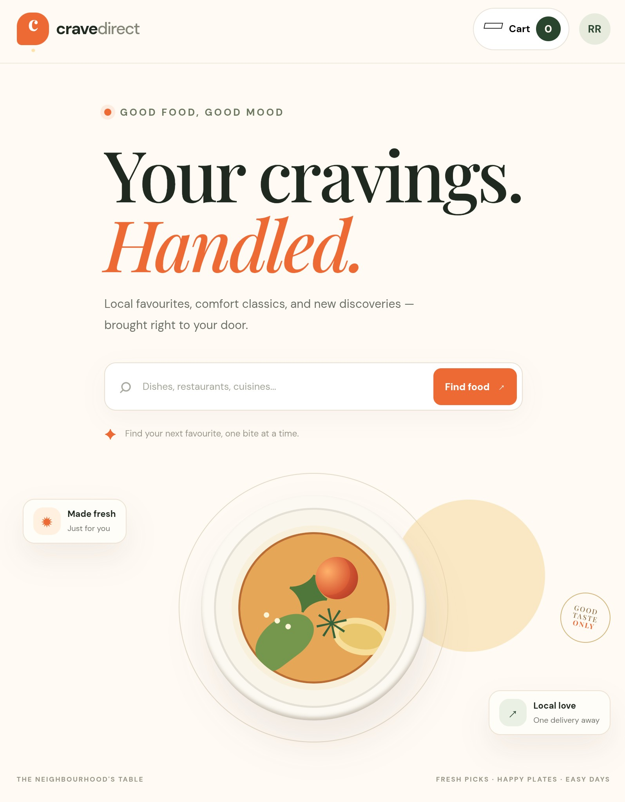
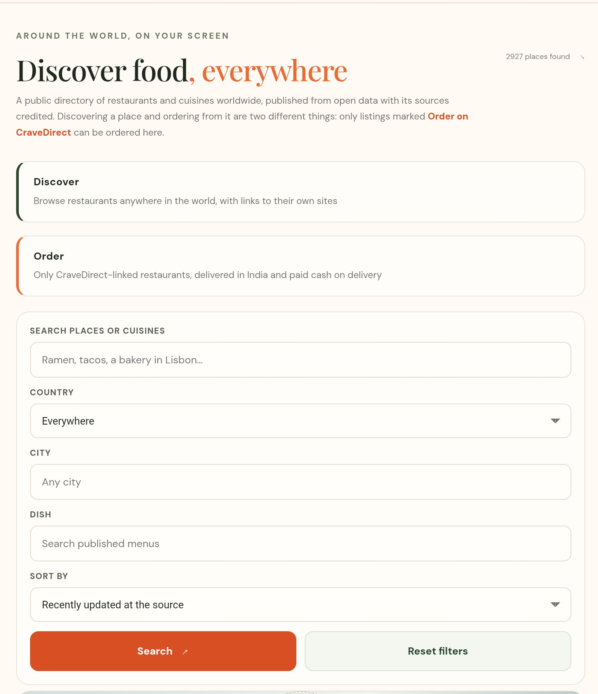
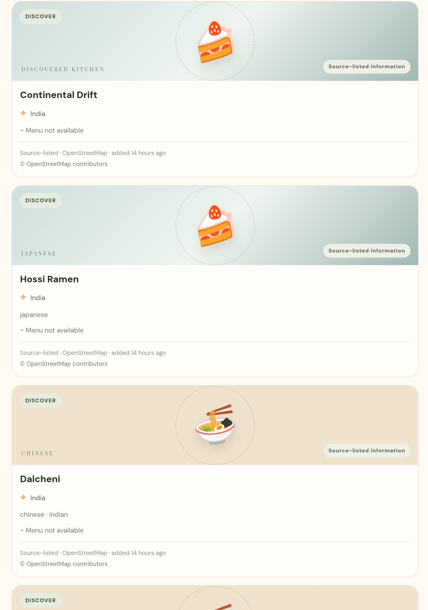
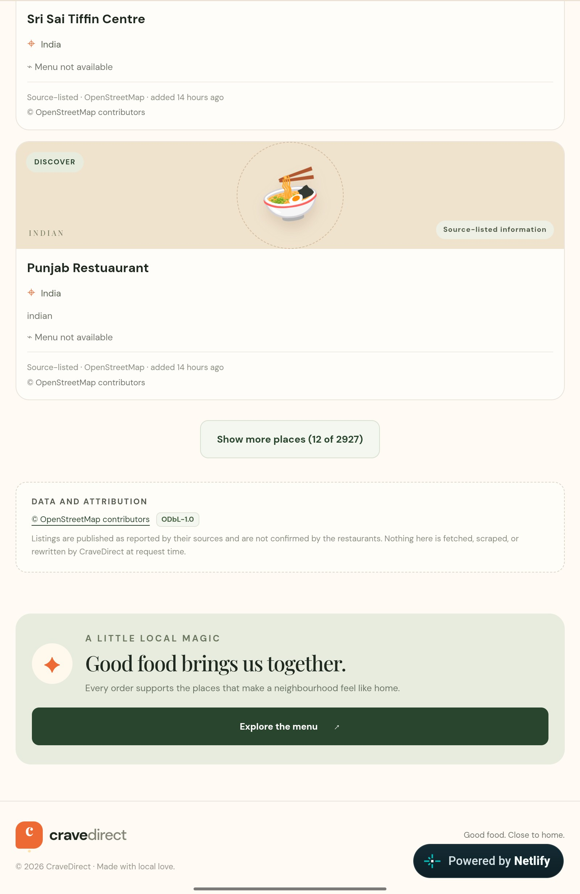
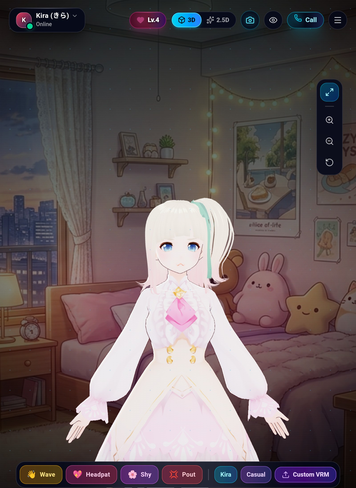

<!-- REYZORA portfolio README: project showcase and verified external links. -->

<h1 align="center">REYZORA</h1>

  <strong>Independent AI research and software projects</strong> 
  A growing portfolio of experiments, engineering work, and deployed applications.

---

## Featured project · RAY-IMAGE

  <strong>I am the creator and primary developer of RAY-IMAGE, an independently built text-to-image research system.</strong> I designed and implemented its custom Variational Autoencoder (VAE), Diffusion Transformer architectures, flow-matching training pipeline, frozen Qwen3-4B text conditioning, classifier-free guidance, latent/text caching, and checkpoint workflows. I have advanced the system through three major DiT generations: the ~60M v3 foundation, a 110.7M dense v4, and a ~482M sparse-MoE v5. I train and iterate on the models using free-tier Kaggle T4 GPUs.

<table>
  <tr>
    <td width="66%" valign="top">
      
      

        Early v3 generated samples: the original visual baseline that informed later v4 and v5 architecture iterations.
      

    </td>
    <td width="34%" valign="top">
      <h3>Project links</h3>
      
<strong>Repository and project overview</strong> 
        <a href="https://github.com/Rishidev-20thcenturey/rustes-generative-ai">Open RAY-IMAGE on GitHub ↗</a>
      

      
<strong>Current research README</strong> 
        <a href="https://github.com/Rishidev-20thcenturey/rustes-generative-ai/blob/main/README.md">Model progression, engineering decisions, and training report ↗</a>
      

      
<strong>v4/v5 implementation history</strong> 
        <a href="https://github.com/Rishidev-20thcenturey/rustes-generative-ai/tree/arena/416eda21-rustes-generative-ai">Inspect the v4/v5 development code ↗</a>
      

      
<strong>Public v5 model artifact</strong> 
        <a href="https://huggingface.co/Rishix500/ray-image-dit-v5-moe">RAY-IMAGE DiT v5 MoE ↗</a>
      

      
<strong>Public training cache</strong> 
        <a href="https://huggingface.co/datasets/Rishix500/monet-qwen-cache-200k-v4">MONET + Qwen3-4B cache ↗</a>
      

      
<strong>Hugging Face profile</strong> 
        <a href="https://huggingface.co/Rishix500">Rishix500 ↗</a>
      

    </td>
  </tr>
</table>

### Architecture and engineering work

| Area | What I built |
|---|---|
| **Latent image pipeline** | Custom VAE v3 for 512 × 512 RGB images, producing 16-channel latents on a 64 × 64 grid |
| **DiT v3 foundation** | Approximately 60M-parameter dense model; established the initial real-image training and generation path |
| **DiT v4** | Counted 110,724,750-parameter dense model with 2D axial RoPE, SwiGLU, and gated text cross-attention |
| **DiT v5 MoE** | Approximately 482M total parameters, around 204M active per token; one shared and eight routed SwiGLU experts with top-2 routing |
| **Text conditioning** | Frozen Qwen3-4B hidden states, 2,560 dimensions, truncated to 128 tokens |
| **Training objective** | Flow matching and velocity prediction; warm-start transfer from the v4 120k checkpoint into v5 |
| **Generation** | Euler integration over the learned velocity field and optional classifier-free guidance |
| **Training infrastructure** | Latent/text cache preparation, checkpoint and EMA handling, resume logic, numerical guards, and Kaggle T4 training workflows |

### Training progress and model behaviour

I trained the v5 MoE run through approximately **171.4k steps**. Between roughly 127k and 170k steps, loss moved from about 1.5 to 1.4 and velocity MSE from about 1.5 to 1.35. The router load-balance term stayed near 1.1, with balanced routing and no observed expert collapse in the reviewed logs.

In the samples reviewed so far, v4 produces more prompt-specific colour and composition than the v5 135k checkpoint. The next quality improvements are stronger object structure and clearer prompt separation. My next validation cycle compares later v5 checkpoints with matched prompts and seeds, and measures conditioning strength by comparing real-prompt and null-prompt velocity predictions at the same noise and timestep.

### Model and artifact access

| Artifact | Access |
|---|---|
| **DiT v5 MoE main repository** | Public; [open model repository](https://huggingface.co/Rishix500/ray-image-dit-v5-moe) |
| **MONET + Qwen cache** | Public; [open dataset](https://huggingface.co/datasets/Rishix500/monet-qwen-cache-200k-v4). Its dataset card currently reports 140,000 samples despite the historical “200k” name. |
| **DiT v4 model and milestones** | Private Hugging Face repositories |
| **DiT v5 milestone repository** | Private Hugging Face repository |
| **VAE v3 512px checkpoint** | Private Hugging Face repository |
| **Legacy v3 checkpoint** | Private Hugging Face repository |

Access was checked on 6 November 2026. The project README documents the model lineage, training diagnostics, engineering priorities, and artifact visibility. The v3 gallery above is a historical output set; v4 and v5 sample comparisons are tracked separately.

## Featured project · CraveDirect

  <strong>CraveDirect</strong> is a deployed food-discovery storefront and full-stack API MVP. It brings restaurant browsing, cuisine filters, menus, cart management, delivery addresses, cash-on-delivery checkout, and order history into one web experience, with a separate read-only directory for discovering restaurants and places.

<table>
  <tr>
    <td width="50%" valign="top">
      
      
Storefront

    </td>
    <td width="50%" valign="top">
      
      
Food discovery

    </td>
  </tr>
  <tr>
    <td width="50%" valign="top">
      
      
Restaurant listings

    </td>
    <td width="50%" valign="top">
      
      
Discovery experience

    </td>
  </tr>
</table>

### Project links

- **[Open the live CraveDirect website ↗](https://cravedirect-web.netlify.app/)**
- **[View the source repository ↗](https://github.com/Rishidev-20thcenturey/food-delivery-api)**
- **[Check the live API health endpoint ↗](https://cravedirect-api.onrender.com/api/v1/health)**

### Technology and scope

| Area | Details |
|---|---|
| **Frontend** | React, TypeScript, Vite |
| **Backend** | Node.js, Express 5, typed REST API |
| **Data and API contract** | PostgreSQL, OpenAPI 3.1, automated tests |
| **Hosting** | Netlify storefront, Render API |
| **Current scope** | Restaurant browsing, filters, cart, addresses, cash-on-delivery checkout, order history, and read-only external discovery |
| **Status** | Deployed MVP/demo; not production-hardened |

> **Scope note:** External discovery listings are not automatically orderable through CraveDirect. Online payments and complete worldwide ordering are not implemented.

## Featured project · AI-WIFU

  <strong>AI-WIFU</strong> is a working full-stack AI companion application centered on expressive anime avatars, character-aware conversation, and live voice interaction. The experience combines animated 2D/3D characters, camera-based vision, generated speech, music, character customization, and browser-side memory in one interface.

<table>
  <tr>
    <td width="66%" valign="top">
      
      

        Actual AI-WIFU lobby screenshot from the original project repository. Select the image to open the live app.
      

    </td>
    <td width="34%" valign="top">
      <h3>Project links</h3>
      
<strong>Live application</strong> 
        <a href="https://live-anime-ai-waifu.ai.studio/">Open AI-WIFU online ↗</a>
      

      
<strong>Source code</strong> 
        <a href="https://github.com/Rishidev-20thcenturey/AI-WIFU-">Open the original AI-WIFU repository ↗</a>
      

      
<strong>Technical documentation</strong> 
        <a href="https://github.com/Rishidev-20thcenturey/AI-WIFU-#readme">Features, setup, and architecture ↗</a>
      

    </td>
  </tr>
</table>

### Technology and scope

| Area | Details |
|---|---|
| **Frontend** | React 19, TypeScript, Vite, Tailwind CSS, Motion |
| **Backend and transport** | Node.js, Express, HTTP API routes, WebSocket live-audio bridge |
| **AI integration** | Google Gemini APIs for chat, voice, transcription, vision, and optional music generation |
| **Avatar and interaction** | Three.js, VRM avatar rendering, 2D canvas character, expressions, lip-sync and customization |
| **Personalization** | Character presets, conversation history, affection score, and browser-local memory |
| **Live demo** | [live-anime-ai-waifu.ai.studio](https://live-anime-ai-waifu.ai.studio/) |
| **Status** | Working integrated application; external AI access and browser permissions affect some features |

> **Deployment and privacy note:** The app uses browser storage for some profile, chat, and memory data, and sends selected prompts, images, or audio to the configured AI provider when those features are used. The source README documents remaining deployment-hardening needs, including backend access controls and rate limiting. The live link is provided as an entry point; availability and all provider-dependent features are not independently guaranteed by this portfolio.

---

## More projects

Additional projects will be documented here one at a time, with their own verified screenshots, original repository links, live demos where available, and model or dataset links when applicable.

> **Portfolio scope:** This repository is a project index. The original repositories remain the source of truth for their code and development history; this README does not copy or modify their source files.
