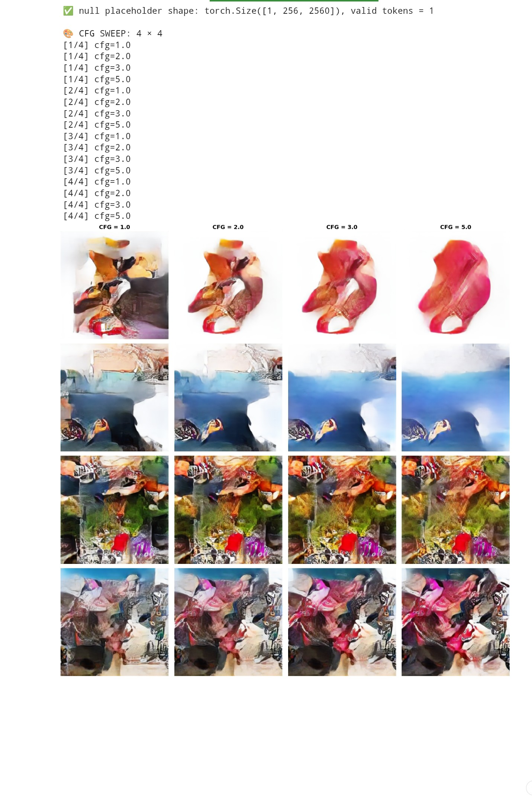
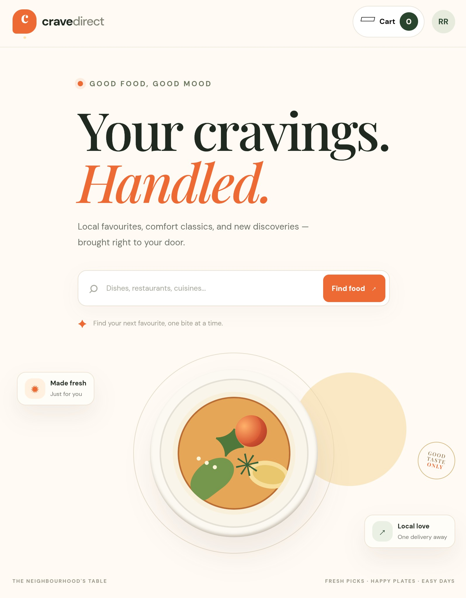
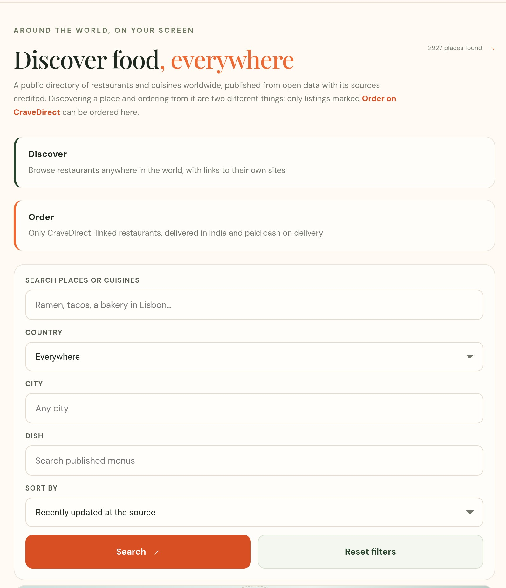
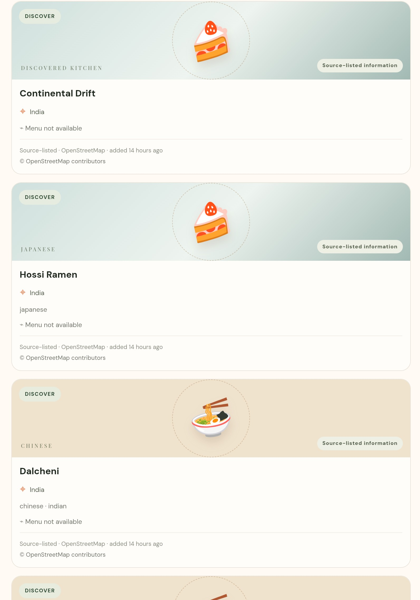
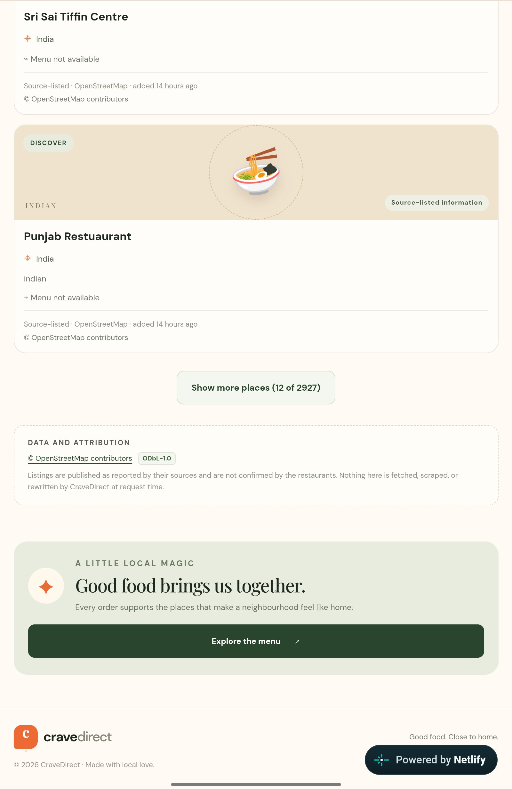

<!-- REYZORA portfolio README: project showcase and verified external links. -->

<h1 align="center">REYZORA</h1>

  <strong>Independent AI research and software projects</strong> 
  A growing portfolio of experiments, engineering work, and deployed applications.

---

## Featured project · RAY-IMAGE

  <strong>RAY-IMAGE</strong> is an ongoing from-scratch text-to-image research project exploring a custom Variational Autoencoder (VAE), Diffusion Transformer (DiT), flow matching, and frozen Qwen text conditioning. It is a research preview—not a finished, quality-validated image-generation product.

<table>
  <tr>
    <td width="66%" valign="top">
      
      

        RAY-IMAGE architecture schematic from the original repository. This is a pipeline illustration, not a generated image sample.
      

    </td>
    <td width="34%" valign="top">
      <h3>Project links</h3>
      
<strong>Source code</strong> 
        <a href="https://github.com/Rishidev-20thcenturey/rustes-generative-ai">Open the original RAY-IMAGE repository ↗</a>
      

      
<strong>Model artifact</strong> 
        <a href="https://huggingface.co/Rishix500/ray-image-dit-n8-v2">RAY-IMAGE · N8 v2 on Hugging Face ↗</a>
      

      
<strong>Training cache</strong> 
        <a href="https://huggingface.co/datasets/Rishix500/monet-qwen-cache-200k">MONET + Qwen cache dataset ↗</a>
      

      
<strong>Hugging Face profile</strong> 
        <a href="https://huggingface.co/Rishix500">Rishix500 ↗</a>
      

    </td>
  </tr>
</table>

### At a glance

| Area | Details |
|---|---|
| **Goal** | Research a text-conditioned image-generation pipeline built from underlying components |
| **Core architecture** | Diffusion Transformer (DiT) with flow-matching experiments |
| **Image representation** | Custom VAE latent pipeline; current research path targets 256 × 256 RGB output |
| **Text conditioning** | Frozen Qwen3-4B hidden states in the current real-world training path |
| **Data workflow** | MONET image-caption data and cached latent/text embeddings |
| **Status** | Active research preview; no final image-quality benchmark or validated production release is claimed |

### Important status note

The source code, model artifact, and training cache are maintained in their original locations and linked above. The Hugging Face checkpoint is experimental; the existence of a checkpoint or inference entry point does not, by itself, establish reliable generated-image quality.

## Featured project · CraveDirect

  <strong>CraveDirect</strong> is a deployed food-discovery storefront and full-stack API MVP. It brings restaurant browsing, cuisine filters, menus, cart management, delivery addresses, cash-on-delivery checkout, and order history into one web experience, with a separate read-only directory for discovering restaurants and places.

<table>
  <tr>
    <td width="50%" valign="top">
      
      
Storefront

    </td>
    <td width="50%" valign="top">
      
      
Food discovery

    </td>
  </tr>
  <tr>
    <td width="50%" valign="top">
      
      
Restaurant listings

    </td>
    <td width="50%" valign="top">
      
      
Discovery experience

    </td>
  </tr>
</table>

### Project links

- **[Open the live CraveDirect website ↗](https://cravedirect-web.netlify.app/)**
- **[View the source repository ↗](https://github.com/Rishidev-20thcenturey/food-delivery-api)**
- **[Check the live API health endpoint ↗](https://cravedirect-api.onrender.com/api/v1/health)**

### Technology and scope

| Area | Details |
|---|---|
| **Frontend** | React, TypeScript, Vite |
| **Backend** | Node.js, Express 5, typed REST API |
| **Data and API contract** | PostgreSQL, OpenAPI 3.1, automated tests |
| **Hosting** | Netlify storefront, Render API |
| **Current scope** | Restaurant browsing, filters, cart, addresses, cash-on-delivery checkout, order history, and read-only external discovery |
| **Status** | Deployed MVP/demo; not production-hardened |

> **Scope note:** External discovery listings are not automatically orderable through CraveDirect. Online payments and complete worldwide ordering are not implemented.

---

## More projects

Additional projects will be documented here one at a time, with their own verified screenshots, original repository links, live demos where available, and model or dataset links when applicable.

> **Portfolio scope:** This repository is a project index. The original repositories remain the source of truth for their code and development history; this README does not copy or modify their source files.
